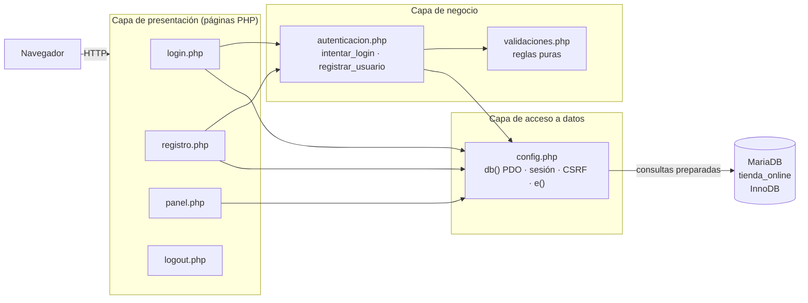
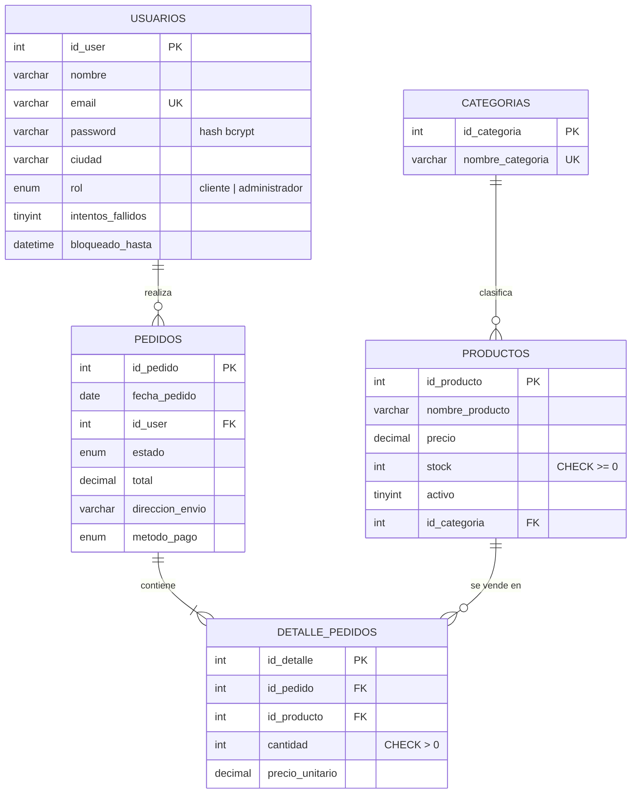
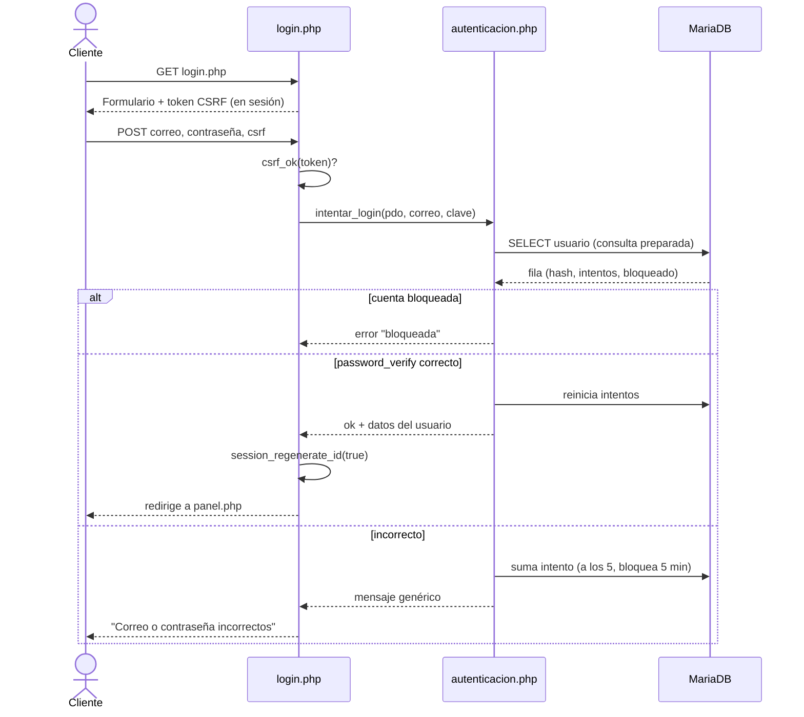
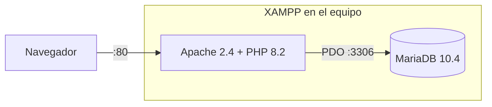

# Arquitectura de la solución

## 1. Visión general

Aplicación web de **arquitectura en capas** sobre páginas PHP (cada página actúa como controlador y vista) con una base de datos relacional. No usa un framework MVC: es un monolito sencillo, apropiado para el alcance del PPA, en el que la lógica de negocio está separada de las páginas para poder probarla.

| Capa | Archivos | Responsabilidad |
|---|---|---|
| Presentación | `login.php`, `registro.php`, `panel.php`, `logout.php` | Recibir la petición, validar el token CSRF, llamar a la lógica y mostrar HTML (con `e()` para escapar) |
| Negocio | `autenticacion.php`, `validaciones.php` | Reglas de login, bloqueo, registro y validación de datos. No imprime HTML |
| Acceso a datos | `config.php` (`db()`) | Conexión PDO única, consultas preparadas, sesión segura |
| Datos | `database/tienda_online.sql` | Esquema, restricciones y datos de ejemplo |

Las funciones de negocio reciben la conexión `PDO` **por parámetro** (inyección de dependencias manual). Gracias a eso las pruebas pueden usar una base de datos de prueba sin modificar el código.

## 2. Modelo de datos

### Cambios frente al volcado original

| Problema detectado | Solución |
|---|---|
| 9 de 10 usuarios con contraseña vacía | `password` NOT NULL con hash bcrypt; las 10 cuentas migradas |
| Correo sin restricción | `UNIQUE` en `email` |
| Sin roles | Columna `rol` (cliente / administrador) |
| Sin inventario | `stock` con `CHECK (stock >= 0)` |
| Precio histórico no guardado | `precio_unitario` en `detalle_pedidos` |
| Pedido sin estado, total, dirección ni pago | Columnas `estado`, `total`, `direccion_envio`, `metodo_pago` |
| Llaves foráneas con NULL | `id_user`, `id_categoria`, `id_pedido`, `id_producto` en `NOT NULL` |

### Normalización

El modelo cumple 1FN (valores atómicos), 2FN y 3FN (sin dependencias parciales ni transitivas): las categorías están en su propia tabla y el detalle del pedido en otra.

Hay **dos redundancias deliberadas**:

- `precio_unitario` en `detalle_pedidos`: conserva el precio vigente al momento de la compra, aunque el producto cambie después.
- `total` en `pedidos`: valor derivado (suma de cantidad × precio_unitario) que evita recalcular en cada listado. Su consistencia se verifica con la prueba `B11`.

## 3. Flujo de inicio de sesión

## 4. Decisiones de diseño

| Decisión | Motivo |
|---|---|
| PHP 8 + MariaDB/InnoDB sobre XAMPP | Es lo disponible en el aula; InnoDB da llaves foráneas y transacciones |
| PDO con consultas preparadas (`ATTR_EMULATE_PREPARES = false`) | Evita inyección SQL separando código y datos |
| `password_hash` / `password_verify` con bcrypt | Algoritmo lento con sal incorporada; resiste fuerza bruta |
| Token CSRF por sesión + `hash_equals` | Impide envíos de formularios desde otros sitios |
| `session_regenerate_id(true)` al iniciar sesión | Evita la fijación de sesión |
| Mensaje de error genérico | No revela si un correo está registrado |
| Bloqueo por 5 intentos fallidos durante 5 minutos, guardado en la BD | Frena la fuerza bruta aunque el atacante cambie de IP o de sesión |
| La comparación de fechas del bloqueo se hace en SQL (`NOW()`) | Una primera versión comparaba en PHP y dependía de la zona horaria configurada en `php.ini`; hacerlo en SQL evita ese error |
| Lógica de negocio separada de las páginas | Permite probarla sin navegador |

## 5. Despliegue

## 6. Limitaciones y trabajo futuro

- Las credenciales de la base de datos están en `config.php`; en producción deben ir en variables de entorno.
- Falta HTTPS y la bandera `secure` de la cookie de sesión (en local se usa HTTP).
- Falta implementar carrito y creación de pedidos con varios productos (sprints 2 y 3).
- `logout.php` responde a GET; lo ideal es POST con token CSRF.
